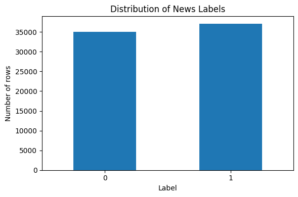
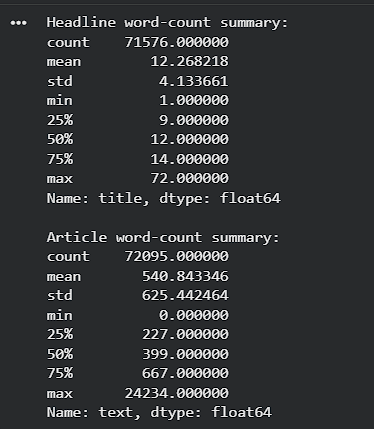
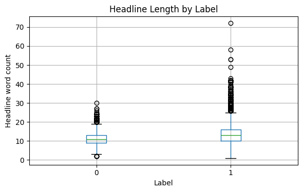
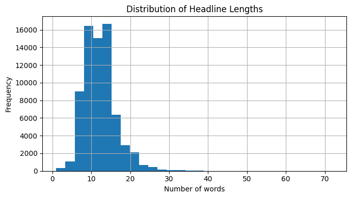
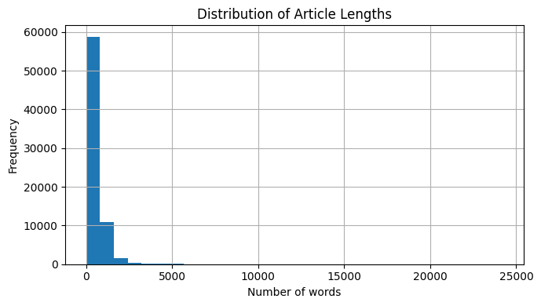
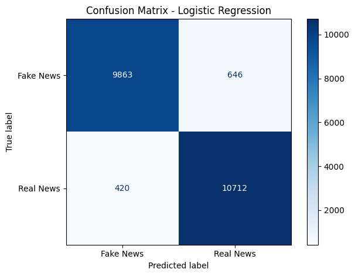
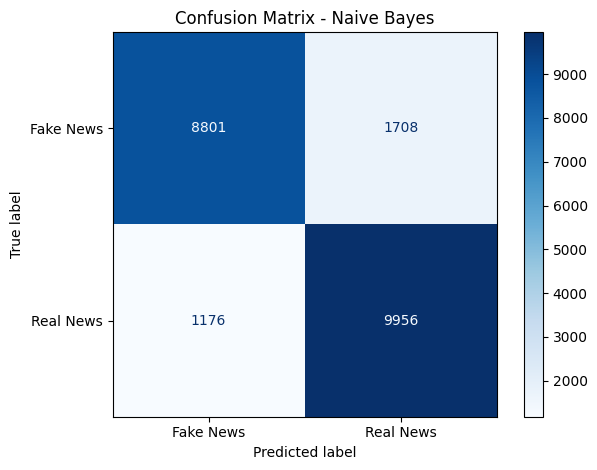
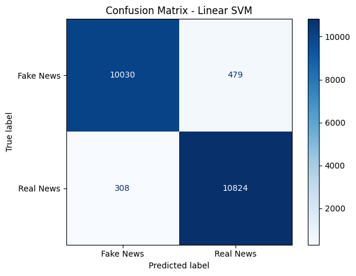
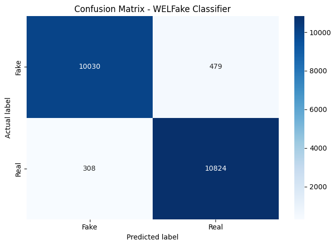

# Fake News Detection Using Machine Learning

## 1. Project Overview

This project explores the application of Natural Language Processing (NLP) and Machine Learning techniques to classify news articles as **Fake News or Real News**.

Using the WELFake dataset, I performed Exploratory Data Analysis (EDA), text preprocessing, feature extraction using TF-IDF, and trained three different machine learning classifiers.

The performance of the models was evaluated using accuracy, precision, recall, F1-score, confusion matrices, and error analysis.

The main objective was to investigate how effectively machine learning algorithms can identify patterns in news articles and distinguish between the two categories.

## 2. Project Objectives

- Explore and understand the structure of the WELFake dataset.
- Perform Exploratory Data Analysis to identify patterns and characteristics.
- Examine missing values, duplicate entries, and text-length distributions.
- Clean and preprocess textual data for machine learning.
- Convert textual information into numerical features using TF-IDF.
- Train and compare different machine learning classifiers.
- Evaluate model performance using standard classification metrics.
- Perform error analysis to understand misclassified news articles.

## 3. Dataset Description

**Dataset:** WELFake Dataset

The dataset contains 72,134 news records with the following columns:

| Column | Description |
|---|---|
| Unnamed: 0 | Dataset index |
| title | Headline of the news article |
| text | Main article text |
| label | Classification label |

### Label Distribution

The dataset contains two categories:

- `0` = Fake News
- `1` = Real News

| Category | Number of articles | Percentage |
|---|---:|---:|
| Fake News (0) | 35,028 | 48.56% |
| Real News (1) | 37,106 | 51.44% |
| **Total** | **72,134** | **100%** |

The dataset has a relatively balanced distribution between the two classes.

## 4. Exploratory Data Analysis (EDA)

Exploratory Data Analysis was performed to understand the dataset before applying machine learning techniques.

### 4.1 Dataset Structure

- Total records: 72,134
- Total columns: 4
- Data types: Integer and Object

### 4.2 Missing Values

The initial missing-value analysis showed:

| Column | Missing values |
|---|---:|
| Unnamed: 0 | 0 |
| title | 558 |
| text | 39 |
| label | 0 |

Missing values were inspected before proceeding with preprocessing.

### 4.3 Duplicate Analysis

Duplicate entries were investigated using:

- Exact duplicate rows
- Repeated titles
- Repeated article texts
- Repeated title-text combinations

Observations:

- Exact duplicate rows: 0
- Repeated title occurrences: 9,786
- Repeated text occurrences: 9,415
- Repeated title-text pair occurrences: 8,456
- Title-text groups with conflicting labels: 0

This analysis helped identify repeated content within the dataset.

### 4.4 Text Length Distribution

The word-count distributions of headlines and article texts were examined using histograms and box plots.

**Headline statistics:**

- Mean word count: 12.27
- Median word count: 12
- Maximum word count: 72

**Article text statistics:**

- Mean word count: 540.84
- Median word count: 399
- Maximum word count: 24,234

Compares headline word counts between fake and real news. Real news headlines have a higher median word count, with several longer-headline outliers.

Displays descriptive statistics for headline and article word counts, including mean, standard deviation, median, quartiles and maximum values.

| Label | Median headline length | Median article length |
|---|---:|---:|
| Fake News (0) | 11 | 427 |
| Real News (1) | 13 | 369 |

The median headline and article lengths were also compared across the two labels.

These differences indicate variations in text length between the two categories, although text length alone cannot determine whether an article is fake or real.

### 4.5 Word Frequency Analysis

The most frequently occurring words were examined separately for both labels.

The analysis involved:
- Converting text to lowercase.
- Removing punctuation.
- Identifying frequently occurring words.
- Comparing frequent words between the two categories.

Stop-word removal was subsequently applied during text preprocessing to focus on more informative terms.

## 5. Text Preprocessing

Text preprocessing was performed to prepare the news articles for machine learning.

The following operations were implemented:

1. Converted text into lowercase.
2. Removed URLs and website links.
3. Removed punctuation and non-alphabetic characters.
4. Tokenized text into individual words.
5. Removed English stop words using Scikit-learn's `ENGLISH_STOP_WORDS`.
6. Joined the cleaned tokens back into text.

Missing article texts were handled using empty strings during preprocessing.

**Important:** The article text (`text` column), rather than the headline, was used as the primary input feature for model training.

## 6. Train-Test Split

The dataset was divided into training and testing subsets using `train_test_split()`.

Parameters:

- Training set: 70%
- Testing set: 30%
- Random state: 42
- Stratification: Enabled

| Dataset | Number of records |
|---|---:|
| Training set | 50,493 |
| Testing set | 21,641 |

Stratification was used to maintain the original class distribution in both subsets.

## 7. Feature Extraction Using TF-IDF

Machine learning algorithms require numerical input. Therefore, TF-IDF (Term Frequency–Inverse Document Frequency) was used to transform the cleaned news articles into numerical feature vectors.

The following parameters were used:

| Parameter | Value | Purpose |
|---|---|---|
| max_features | 20,000 | Limits the vocabulary to 20,000 features |
| ngram_range | (1, 2) | Considers individual words and two-word combinations |
| min_df | 2 | Ignores terms appearing in fewer than two documents |
| max_df | 0.95 | Ignores terms appearing in more than 95% of documents |
| stop_words | English | Removes English stop words |
| sublinear_tf | True | Applies logarithmic scaling to term frequency |

The resulting training and testing feature matrices had the following dimensions:

- Training matrix: (50,493, 20,000)
- Testing matrix: (21,641, 20,000)

TF-IDF was fitted on the training data and then applied to the testing data through the model pipelines.

## 8. Machine Learning Models

Three machine learning algorithms were implemented and compared.

### 8.1 Logistic Regression

Logistic Regression was used as a baseline classification model.

It estimates the probability of an article belonging to either the fake or real news category.

Parameter:
- max_iter = 1000

Evaluates Logistic Regression classification performance. The model correctly classified 9,863 fake news articles and 10,712 real news articles.

### 8.2 Multinomial Naive Bayes

Multinomial Naive Bayes was implemented as a probability-based classification approach.

It uses word-feature information to estimate the probability of a news article belonging to a particular category.

Parameter:
- alpha = 1.0

Shows the classification performance of Multinomial Naive Bayes. It correctly classified 8,801 fake news articles and 9,956 real news articles.

### 8.3 Linear Support Vector Machine (Linear SVM)

Linear SVM was implemented to identify a decision boundary that separates fake and real news articles in the TF-IDF feature space.

Parameter:
- C = 1.0

All three models were implemented using Scikit-learn pipelines containing TF-IDF vectorization and the respective classifier.

Shows the classification performance of Linear SVM. It correctly classified 10,030 fake news articles and 10,824 real news articles.

## 9. Model Evaluation

The models were evaluated using the following metrics:

- **Accuracy:** Overall proportion of correctly classified articles.
- **Precision:** Proportion of predicted positive classifications that were correct.
- **Recall:** Proportion of actual positive classifications correctly identified.
- **Macro F1-score:** Harmonic mean of precision and recall, calculated independently for both classes and averaged equally.

### 9.1 Model Comparison

The following results were obtained on the test dataset:

| Model | Accuracy | Macro Precision | Macro Recall | Macro F1 |
|---|---:|---:|---:|---:|
| Logistic Regression | 95.07% | 95.11% | 95.04% | 95.07% |
| Naive Bayes | 86.67% | 86.78% | 86.59% | 86.64% |
| Linear SVM | **96.36%** | **96.39%** | **96.34%** | **96.36%** |

### 9.2 Model Performance Observations

- Linear SVM achieved the highest accuracy and macro F1-score among the three models.
- Logistic Regression also demonstrated strong classification performance.
- Multinomial Naive Bayes achieved comparatively lower performance.
- Linear SVM performed best on the given test dataset.

Based on these results, Linear SVM was selected for further examination through error analysis.

## 10. Confusion Matrix and Error Analysis

A confusion matrix was generated to examine the classification performance of the models.

The confusion matrix helps distinguish between:

- True Positives
- True Negatives
- False Positives
- False Negatives

For this project, the two classification errors were examined as follows:

**False Positive:** An actual real news article classified as fake.

**False Negative:** An actual fake news article classified as real.

### 10.1 Linear SVM Error Analysis

The Linear SVM model produced the following results:

| Error category | Number of articles |
|---|---:|
| False Positives (Real → Fake) | 308 |
| False Negatives (Fake → Real) | 479 |
| Total misclassified articles | 787 |

The model's test accuracy was 96.36%.

### 10.2 Examination of Misclassified Headlines

Examples of incorrectly classified headlines were extracted for all three models.

Some examples from the Linear SVM error analysis included:

- "What a Sensory Isolation Tank Taught Me About ..."
- "Cuba releases all 53 political prisoners to co..."
- "Making the Transition Less Chaotic"
- "JIMMY KIMMEL: Republicans ‘Should Be Praying f..."

The actual and predicted labels were compared to identify classification errors.

This step provided an opportunity to examine cases where the models failed to correctly classify news articles.

Misclassification can arise from ambiguous wording, overlapping vocabulary, contextual information, and patterns that may not be sufficiently captured by the selected features.

## 11. Key Findings

The project produced several observations:

1. The WELFake dataset contains a relatively balanced distribution of fake and real news articles.
2. The two categories exhibit differences in headline and article-length distributions.
3. TF-IDF successfully transformed textual information into numerical features suitable for machine learning.
4. Linear SVM achieved the best overall performance among the three classifiers.
5. Logistic Regression also performed well, achieving an accuracy of approximately 95%.
6. Error analysis revealed that the model still misclassified some articles despite its high overall accuracy.

The results demonstrate the usefulness of classical machine learning algorithms for text classification.

## 12. Limitations

- The classification models depend on the patterns and labels present in the training dataset.
- High classification accuracy does not guarantee that a news article is factually true or false.
- The models primarily learn textual patterns rather than independently verifying claims.
- The dataset may contain biases, repeated content, and limitations in its original labels.
- Further testing on independent and more recent news datasets would be necessary to evaluate generalization.

Therefore, this project should be considered a text-classification experiment rather than a fact-checking system.

## 13. Technologies and Libraries Used

- Python
- Jupyter Notebook
- Pandas
- NumPy
- Matplotlib
- Seaborn
- Regular Expressions (re)
- Scikit-learn
- TF-IDF Vectorization
- Logistic Regression
- Multinomial Naive Bayes
- Linear Support Vector Machine

## 14. How to Run the Project
1. Clone or download this repository.
2. Download the dataset and place `WELFake_Dataset.csv` from the Raw data folder.
3.  Open `Fake_news_project.ipynb` in Jupyter Notebook or upload it to Google Colab.
4. Run the cells in order, from data loading and EDA through model training, evaluation, and error analysis.

## 15. Group Member
1. Sanlap Tarafder (MS24011)
2. Chayan Banerjee (MS24013)
3. Surajit Shit    (MS24169)

## 16. Conclusion

This project provided practical experience in applying Natural Language Processing and classical Machine Learning algorithms to a real-world text-classification problem.

Starting with Exploratory Data Analysis, the workflow progressed through text preprocessing, TF-IDF feature extraction, model training, evaluation, and error analysis.

Among the three models investigated, Linear SVM achieved the highest test accuracy of **96.36%**, followed by Logistic Regression at 95.07% and Multinomial Naive Bayes at 86.67%.

Beyond comparing model performance, the project highlighted the importance of examining misclassified examples and understanding the limitations of automated text classification.

The project strengthened my understanding of the end-to-end machine learning workflow, particularly in handling textual datasets and evaluating classification models.

---

*An academic project exploring text classification and machine learning using Python.*
